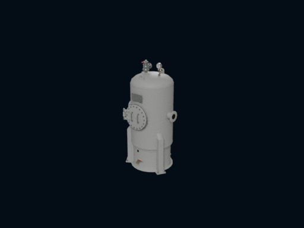

# AnyMachine para Houdini 22 e Redshift

## Os quatro módulos num só projeto

O [manifesto da oficina](examples/workshop.json) monta um cenário **AnyScene**, uma bancada **AnyKit**, um portátil e um reservatório **AnyMachine** e duas câmaras **AnyShot**. Um único clone inclui os quatro módulos. O palco usa metros, Y-up e ACEScg.

```shell
hython anymachine.py production examples/workshop.json out/oficina_v001 --hip
```

Abre o HIP dentro de `out/oficina_v001`. Em Solaris, segue os nós `ANYSCENE → ANYKIT → ANYMACHINE → ANYSHOT → BEAUTY → OUT`. Cada nó carrega uma camada USD própria. O nó `REDSHIFT` renderiza a câmara de montagem. Para transportar a produção, copia a pasta completa, incluindo `layers/`.

O manifesto controla a sala, os objetos, as posições em metros, os controlos de cada máquina e os planos. O exemplo tem 96 frames a 24 fps e muda de plano na frame 49. Para obter um EXR, acrescenta `--render still --frame 49` e usa uma pasta de saída nova. Para uma sequência EXR, usa `--render sequence`. Para uma cópia de revisão MP4 com a transformação OCIO do projeto, usa `--render video` com FFmpeg disponível e ajusta `--display` e `--view` à tua configuração.

As versões incluídas dos três forks vivem em [AnyScene](family/anyscene), [AnyKit](family/anykit) e [AnyShot](family/anyshot). Cada pasta conserva a licença e o código upstream. Para esta produção, a entrada é `anymachine.py production`; os serviços fal e as render farms do upstream têm configuração própria.

## AnyMachine por si só

Constrói máquinas com peças editáveis, anima os mecanismos e prepara a cena em Solaris. O fork inclui 41 modelos, uma [skill para agentes](.agents/skills/anymachine-houdini-redshift/SKILL.md) e uma cena Houdini Indie pronta a abrir.

[Descarrega a cena do reservatório](examples/air_receiver_hip.zip), extrai a pasta e abre `air_receiver_v004.hiplc`. Mantém a pasta `air_receiver_v004_data` ao lado da cena. Em `/stage/REDSHIFT`, **Render to Disk** escreve o EXR.



O [EXR original](examples/air_receiver.exr) tem 512 × 384 píxeis, RGBA em ACEScg. Foi renderizado a partir da cena reaberta em Houdini Indie 22.0.466 com Redshift 2027.0.4.

## Gerar uma cena

Usa o `hython` do Houdini 22. No Windows, abre **Houdini Command Line Tools** e entra na pasta deste repositório. A extensão da cena depende da licença, por exemplo `.hiplc` para Indie. Para renderizar, instala o plugin Redshift e o delegate Solaris correspondentes à tua build. [Configuração da Maxon](https://help.maxon.net/r3d/houdini/en-us/Content/html/Houdini%2BPlugin%2BConfiguration.html)

```shell
hython anymachine.py list
hython anymachine.py list laptop
hython anymachine.py hip laptop out/laptop_v001.hiplc --set open=0.72
hython anymachine.py usd spider out/spider_walk.usdc --clip walk
hython anymachine.py glb rolltop out/rolltop_demo.glb --clip demo
hython anymachine.py check out/spider_walk.usdc --frame 13
hython check_rigs.py --asset quadruped --surfaces
```

Escolhe um nome de saída novo a cada versão. No HIP, os controlos estão em `/stage/MACHINE`. **Manual pose** permite editar cada controlo de 0 a 1. Ao gerar uma cena com `--clip`, a timeline recebe a duração e os fps do movimento. `STUDIO` controla câmara e resolução. `EXPORT_USD` escreve o palco. Cada peça tem um caminho em `/Machine/Parts` e os materiais estão em `/Machine/Looks`.

Os comandos USD e GLB também funcionam em Python com `numpy` e `usd-core`. O USD leva os materiais RS Standard e de pré-visualização. O GLB leva materiais PBR e o clip escolhido. O GLB do Stilt conserva os três clips originais. Mantém mapas e pastas criados ao lado do USD ou HIP quando os mudares de sítio.

## Modelos e cobertura

| Família | O que podes usar |
|---|---|
| Portátil | Dobradiça de 0–135°, teclado, ecrã com UV e animações de abertura. |
| Quadrúpede e aranha | 4 e 8 pernas, controlos por junta, IK, ciclos de marcha e poses. |
| Mochilas | Daypack, rolltop e rucksack. Fecho, enchimento, aba, rolo e alças conforme o modelo. |
| Stilt | 160 malhas, 104 juntas, 3 movimentos e 6 texturas. Conversão do GLB publicado para UsdSkel. |
| Indústria | 12 equipamentos, 19 variantes de luminárias, helicóptero, embarcação de salvamento e turco. |
| Props externos | Três modelos do original dependem de um pack comercial ausente. Com a malha licenciada em USD, usa `hip` ou `usd` com `--source ficheiro.usd`. |

Os seis rigs do portátil, robôs e mochilas usam carcaças reconstruídas a partir das medidas publicadas. Nos modelos industriais, materiais e geometria preservam a separação por peça. Alguns decalques, sujidade projetada e texturas de desgaste do bake original ficam como referência visual.

## Verificação

Reabrimos os 41 modelos em USD e verificámos a topologia e as ligações dos materiais Redshift. Nos seis rigs procedurais, o verificador percorreu 49 controlos e 25 clips. No portátil, a folga vertical mínima medida foi 0,24 mm. No quadrúpede, o maior deslizamento acumulado por apoio no trote foi 0,014 mm. O teste de superfícies cobre os pares e as poses identificados no relatório. O render de validação foi feito no reservatório.

O [pipeline](PIPELINE.md) explica como construir e rever uma máquina nova. As [referências](references) conservam imagens, medidas e relatórios históricos. O código original e o respetivo histórico estão disponíveis no [AnyMachine de apekshik](https://github.com/apekshik/anymachine/tree/d5e8889eef0b33e0bbe62ddca6f713f94b154b68). Licença [MIT](LICENSE).
