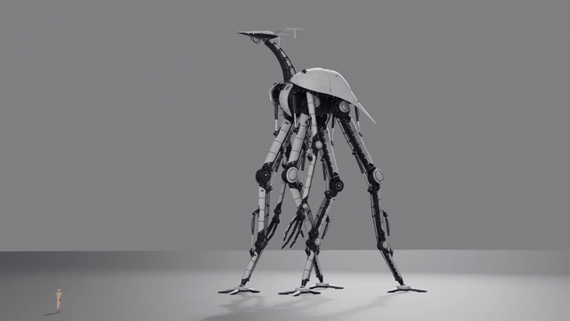
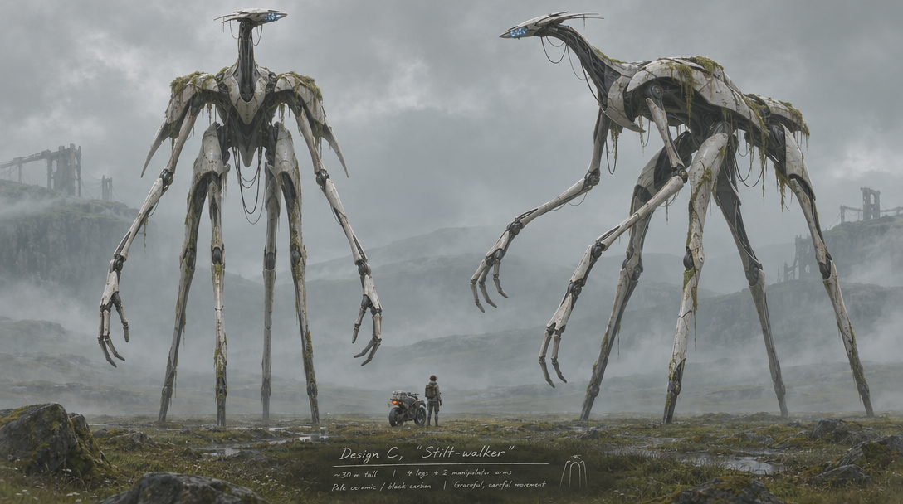
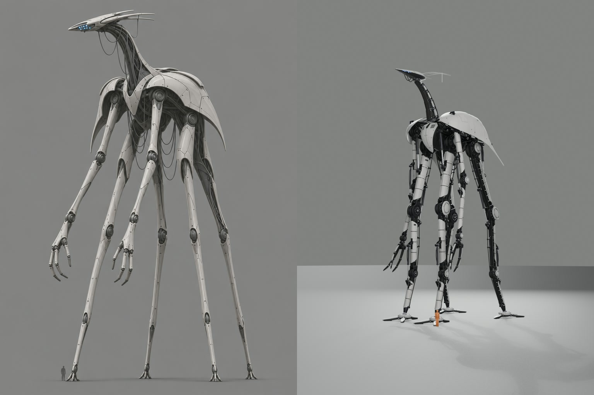
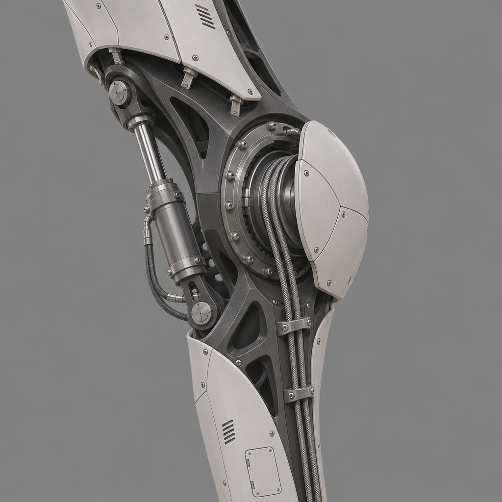
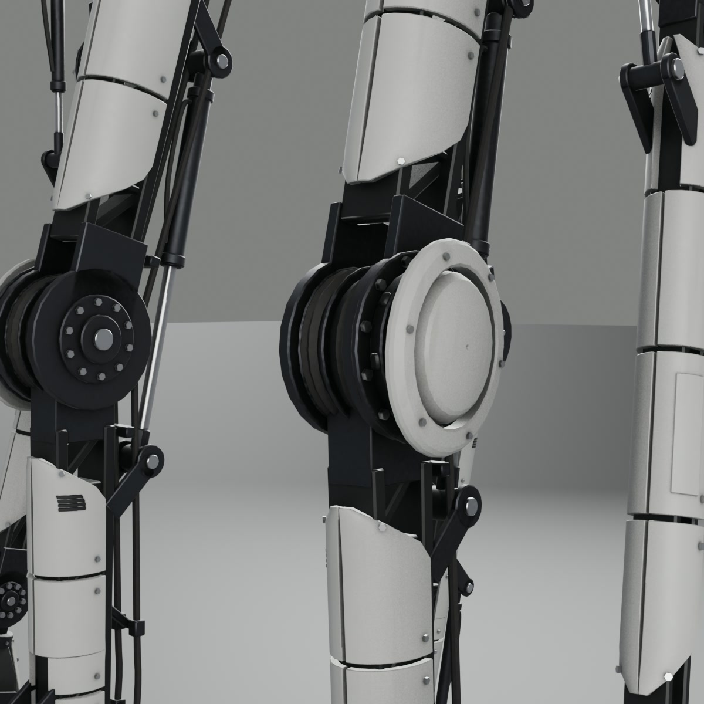

# AnyMachine: machines that work, built in Blender by an agent

Part of a family: [AnyScene](https://github.com/apekshik/anyscene) builds whole sets,
[AnyKit](https://github.com/apekshik/anykit) builds the props that go in them, AnyMachine makes machines that move, and
[AnyShot](https://github.com/apekshik/anyshot) shoots the result.



**Stilt**: a 30 m walker with 160 parts, working hydraulics on every joint, a 104-bone rig and three animations. It
started as one painting. Every part of it is built by [one Python script](stilt/build_stilt.py) that runs in Blender.
The work was done by an agent (Claude Fable 5.2 in Claude Code) following the steps in [PIPELINE.md](PIPELINE.md),
with a person choosing the design and approving each stage.

| Reference | Built |
|---|---|
|  |  |
|  |  |

Video: [`stilt/renders/stilt_reference_to_model.mp4`](stilt/renders/stilt_reference_to_model.mp4) (the build, then
the references beside what was built). Model: [`stilt/stilt.glb`](stilt/stilt.glb).

## Two ways in

**From references, for machines no generator can give you.** One concept image becomes a turnaround, single views
and a close-up plate for every mechanism. A parts breakdown is written from those, then a script that builds the
geometry, materials, rig and animations, and check renders that put each reference beside the model.
[PIPELINE.md](PIPELINE.md) is the method; [`stilt/`](stilt/NOTES.md) is the worked example.

**From a generated mesh, for everyday objects.** Give it an object (a reference image, or a static mesh from a kit)
and it hands back a rig that works: a laptop lid on a real hinge, legs that walk without sliding, a bag that fills
and opens. Every control is a 0-1 parameter, and every result is checked by machine before anyone looks at it.

1. **Generate** the object in an articulated pose (Meshy and Tripo, both tried).
2. **Treat the mesh as a skin.** Measure the joint axes off it, then rebuild the moving parts as clean geometry on
   those axes: coaxial hinge barrels, side-by-side joint slabs, so nothing can pass through anything.
3. **Expose parameters.** Each joint gets a 0-1 custom property with drivers and limits, and bakes to linear glTF
   actions, so `seek(t = value)` poses the GLB in any engine.
4. **Check.** Sweep every parameter for triangle overlaps, clamp out-of-range values, measure foot slip, then
   re-import the GLB to confirm it matches.

**Status: experiments.** This repo holds the five runs so far; there is no endpoint yet.

## Experiments

| | Joints | Result |
|---|---|---|
| [stilt](stilt/NOTES.md) | 4 legs x 3 joints, 2 arms, hands, 5-link neck; 14 hydraulic actuators; walk, reach, head turn | Works. From references, no generated mesh. No intersections through all three actions; plainer than its plates in the hands, elbows and feet |
| [laptop](laptop/NOTES.md) | one lid hinge, 0-135 deg | Works. 0 overlaps over the full sweep, min clearance 0.32 mm |
| [quadruped](quadruped/NOTES.md) | 4 legs x 3 joints; trot, idle, sit, stand | Works. 0 overlaps, 0.014 mm foot slip; legs are plain slabs |
| [spider](spider/NOTES.md) | 8 legs x 3 joints; walk, idle, crouch | Works. 0 overlaps; generators gave 6 legs, the 8 come from the brief; body skin is rough |
| [backpacks](backpacks/NOTES.md) | roll, clip, fill, flap, zip, straps | Partly. The roll-top passes every check; the rucksack and daypack fail where controls interact |

What the backpacks showed: hinges, sliders and wheels cover hard-surface objects, but soft goods need their own joint
types (`flap`, `zip_path`, `fill`, `strap`, `roll`, `clip`, `jiggle`) and a way to say which controls depend on each
other. The notes in `backpacks/` draft them.

## Running

**Stilt** (Blender 5.2). The build needs nothing but the script:

```
blender --background --python stilt/build_stilt.py
blender --background stilt/stilt.blend --python stilt/render_stilt.py -- 3q cu check
blender --background --python stilt/verify_glb.py
```

The first line rebuilds `stilt.blend` and `stilt.glb` from nothing, including the texture bake (about 80 s; add
`--no-bake` to skip it). `stilt/edit.ps1` and `stilt/video.ps1` regenerate the references from the `jobs_*.json`
prompt files and need `FAL_KEY`.

**The others** (Blender 5.0). Each folder has a `run_all.sh` (`run_bag.sh` for the backpacks) that rebuilds
everything from the cached generations in its `gen/` folder, headless. Generations, `.blend` files, GLBs and render
frames are not in the repo; the demo GIFs, stills and `check.json` reports are.
