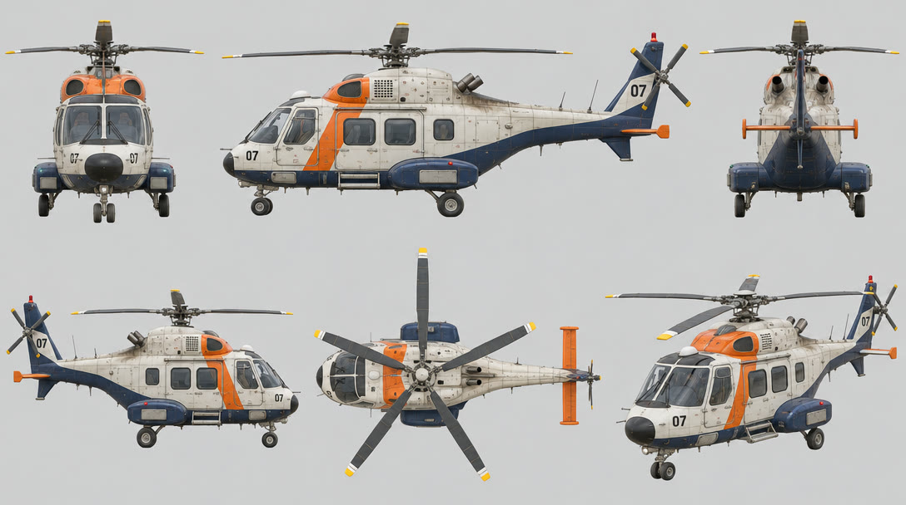
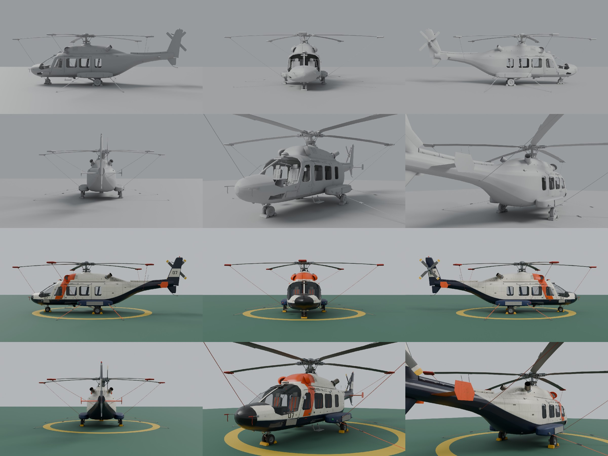
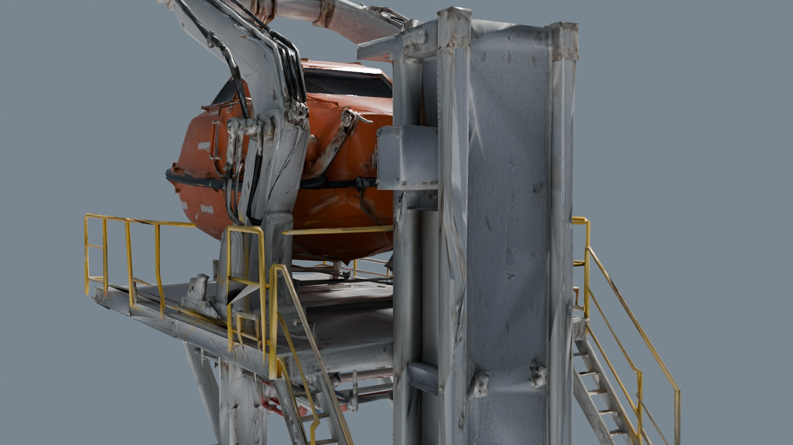
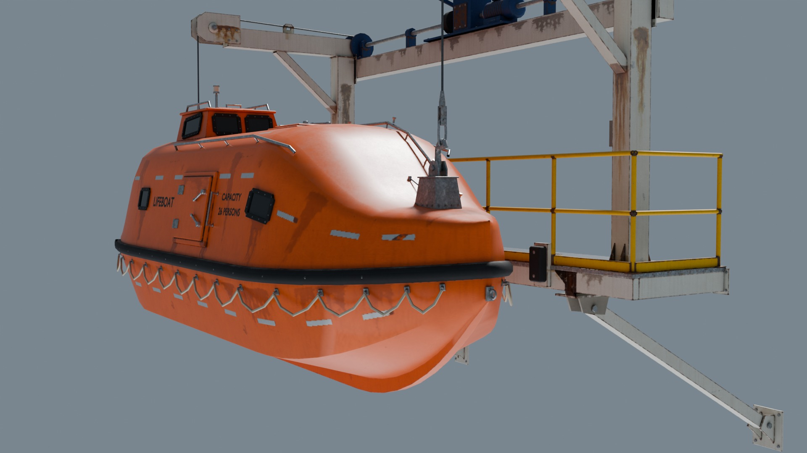

# AnyMachine experiment 6: complicated hard-surface objects, modelled from reference sheets

A lifeboat on its davit, a helicopter, twelve pieces of oil-rig equipment, nineteen light fixtures and three rifles,
made for one map of a browser FPS. None of them moves; what is new is how much is on them. They were built by an
agent (Claude Fable 5.2 in Claude Code) from generated reference sheets, part by part, in Blender Python. The method
is written up in [`../PIPELINE.md`](../PIPELINE.md#part-2-complicated-static-objects); this folder is the worked
example.

It started with a rejection. The map's first lifeboat was an image-to-3D mesh (Meshy). It read as a lifeboat from
far away and as melted plastic up close, and the person the map is for threw it out. The rule since then: **anything
with more than a few parts gets reference sheets first and is then modelled to them.** Generated meshes are no
longer used for hero pieces.

| Reference sheet | Clay, then baked (top two rows clay, bottom two textured) |
|---|---|
|  |  |

| Generated mesh (before) | Modelled (after) |
|---|---|
|  |  |

## What was built

| | Sheets | Result | Where |
|---|---|---|---|
| Lifeboat station | 6 (a turnaround and two close-up sheets for the craft, the same for the davit) | Enclosed survival craft, 7,750 triangles; twin-arm davit with winch, falls and boarding platform, 8,622. One 2048 texture set each | `rig2_blender/kit/lifesaving/` |
| Helicopter | 10 (turnaround, orthographic views, 8 close-up sheets: rotor head, tail, engines, doors, gear, fittings, interior, tie-downs) | 31,477 triangles in six objects: skin, rotor, mechanics, tie-downs, a full cabin and cockpit, glass. Three texture sets (4096, 4096, 2048) | `rig2_blender/kit/aircraft/helicopter/` |
| Equipment kit | 2 per piece, plus a third close-up sheet for the seven busiest | Twelve pieces (valve tree, hydraulic power unit, chemical skid, heat exchanger, air receiver, winch, cable reel and others), 2,195 to 5,914 triangles each, one texture set each | `rig2_blender/kit/equipment/` |
| Light fixtures | 2 per fixture type | Eight types in 19 variants, 3,031 triangles in all, sharing one 2048 texture set; each reviewed lamp off and lamp on | `rig2_blender/kit/lighting/` |
| Rifles | see below | Three first-person rifles, detailed over existing base meshes | `guns/` |

`rig2_blender/kit/README.md` is the brief every agent that built a component was given: sizes, budgets, the
review gate, what may run locally. It is the shortest statement of the rules.

## How one component is made

1. **Sheets.** `gen_sheets.mjs` makes two sheets per object: a turnaround (front, left, back, right, top,
   three-quarter, the first five orthographic) and six construction close-ups (a corner, a joint, the foot, a working
   detail, a plain surface, the most worn spot). Big or busy objects get more: `gen_closeups.mjs`,
   `equipment/gen_close.mjs`, `lifesaving/gen_refs.mjs`, `aircraft/helicopter/gen_refs.mjs` ask for six *named*
   close-ups each, with the object's own turnaround as the input image so the design stays the same. Prompts are kept
   beside the sheets (`*.prompt.txt`).
2. **Model.** One `build.py` per component, on a small shared kit (`hs.py`, with `_pw.py`, `_eq.py`, `lm.py`,
   `lkit.py` on top). The header comment of each script says what the object is made of; the body builds those
   parts one at a time: plates, sections, lathe-turned bodies, pipes, flanges with their bolt circles, hinges,
   handwheels. Real parts are separate meshes that touch the way the real ones do. Anything smaller than about 8 mm
   (bolt heads, weld beads, rivets, panel joints) is built as bake-only geometry and exists in the final model only
   as a normal map.
3. **Compare.** The model is rendered from the same six directions as its turnaround and set beside the sheet
   (`review.jpg` in every component folder; `previews/helicopter/` for the helicopter's views and close-ups). The
   agent looks at the pair and lists what differs in silhouette, part breakdown and colour.
4. **Second pass.** Where the model is plainer than the sheet, the missing parts are added, and where the sheets do
   not show enough to build from, another close-up sheet is generated first. `equipment/review_pass2.jpg` is the
   equipment kit after that pass.
5. **Bake.** A wear shader (paint, chipped edges, grime runs, rust bleed, stains and decals) and the bake-only
   detail are baked in Cycles to base colour, normal and occlusion / roughness / metal maps. Preview bakes
   (512 to 1024 px, a few samples) run locally. Full bakes and final stills run on a GPU render farm: one job per
   component or per texture set, no network inside a job, results collected afterwards.
6. **Export.** `.blend` and `.glb` with the baked set, plus `stats.json` (triangles, bounding box error against the
   intended size, UV fill). A cover prop that is bigger or smaller than its box breaks the game's collision, so the
   build reports the error in millimetres.

`rig2_blender/kit/lifesaving/film/film.py` renders the making-of film: the sheet, the generated mesh, the hand model
going together part by part in clay, its baked textures sweeping on, and the two side by side.
`previews/lifeboat/film_frames.jpg` has four frames of it.

## Where it falls short

Looked at beside their sheets, the models are still simpler and flatter than the references. In particular:

- **Less on them.** The hydraulic power unit has a fraction of the sheet's pipework; the air receiver and heat
  exchanger have fewer nozzles, and what is there is more regular. `equipment/review_pass2.jpg` shows it plainly.
- **Boxier parts.** The helicopter's rotor head has every part (grips, bearings, dampers, pitch links, swashplate,
  servos) as its own mesh, but as blocks and cylinders, not forgings, with no hoses. Window corners are chamfered,
  not round. The nose is blunter than the sheet's.
- **Flatter surfaces.** Rivet rows and panel joints are sparser and fainter than drawn. Paint wear is even where a
  photograph would be patchy. Metals tend to one grey.
- **Things not built.** The helicopter's intake and exhaust covers; the second tread of its boarding step; the
  lifeboat's brake-release wire.
- **The sheets are not engineering drawings.** They are generated images. Views of the same object disagree with
  each other, and sizes come from the map, not the sheet. Where the box the object must fill is a different shape
  from the sheet's object, the script says what was changed (see the header of `equipment/xmas_tree/build.py`).
- **Not all of it has been seen in the game.** The lifeboat stations are placed in the level. The helicopter had
  only been rendered in Blender when this was written.

## The rifles

`guns/` is a different job done with the same habits. The three rifles (two shown here with their scripts) started
as low-detail meshes from a bought asset pack, which had to keep their skeleton, hand positions and sight lines. The
agent rendered a grey close-up of every mechanism, wrote a brief for each one saying what the real part has that the
mesh lacks, then deleted and re-modelled those parts (lathe-turned suppressor with real vent holes, fluted sight
drums, hinge knuckles on a pin, slotted and socket screws, cartridges) and bevelled every hard edge of what was
kept. One of them went from 7,901 to 33,508 triangles.

Two honest notes. The image service refused nearly all of the gun reference prompts, and that was not worked around,
so these were modelled from the grey renders, the written briefs and how the mechanisms work, with one generated
reference between them. And the pack's meshes are not in this repo; `guns/` holds the scripts and a few stills only.

## What is in this folder, and running it

Scripts, sheets (as JPEG), prompts, review images, `stats.json` and the small shared textures. Not here: the
`.blend` and `.glb` results, the full-size baked textures, the level itself, and the farm client.

The folder names under `hardsurface/` (`rig2_blender/kit/...`, `dugout_blender/props_hand/...`) are the game
project's own, kept so that every script finds its helpers unedited. With Blender 5.2:

```
cd hardsurface/rig2_blender/kit
blender -b --factory-startup --python equipment/xmas_tree/build.py -- --nobake                         # geometry only
blender -b --factory-startup --python equipment/xmas_tree/build.py -- --size 512 --spp 4 --noreview    # preview bake
blender -b --factory-startup --python lifesaving/survival_craft/build.py -- --nobake
blender -b --factory-startup --python aircraft/helicopter/build.py -- --nobake
blender -b --factory-startup --python lighting/build.py -- --nobake
```

Those five were run from this copy and finish without errors. The other builds were copied unchanged but not re-run
here. The review scripts expect the sheets as `.png`; they are stored as `.jpg` to keep the repo small. The sheet
generators need `FAL_KEY` in the environment and the manifest's reference photographs, which are not included, so
treat them as a record of how the sheets were asked for. The rifle scripts need the asset pack and will not run
without it.
