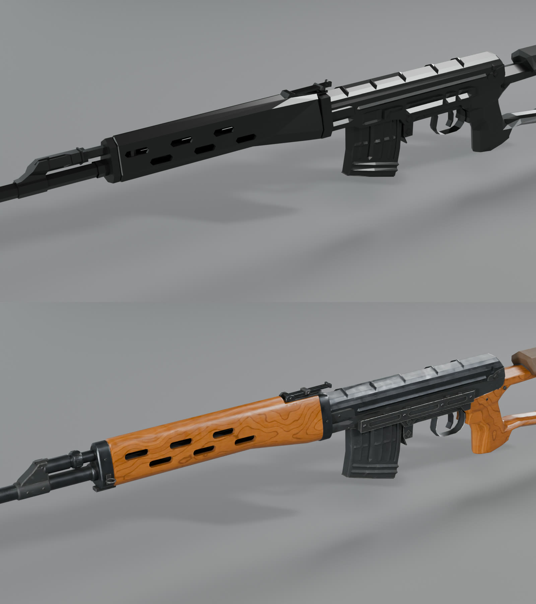
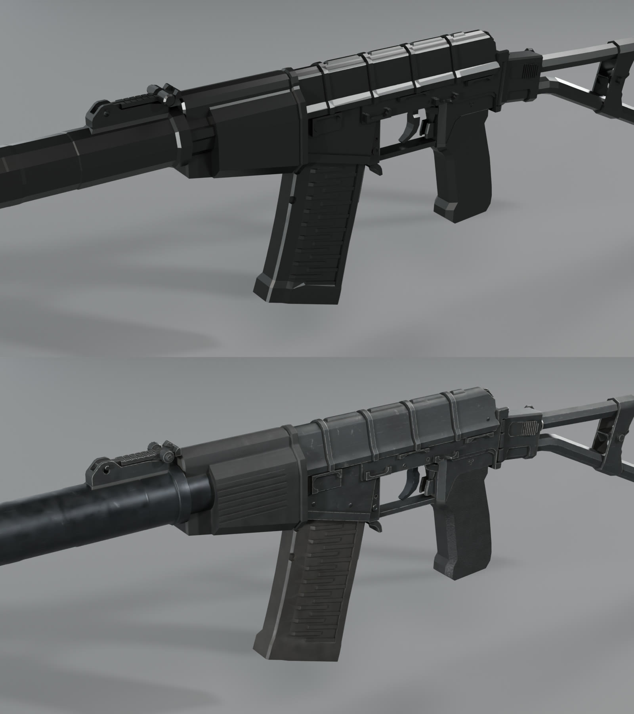

# Rifles: a detail pass over existing meshes

Not built from nothing. Each rifle began as a low-detail mesh from a bought asset pack, already rigged and animated
in the game, so the skeleton, the origin, the hand-contact surfaces, the magazine well and the sight line had to
stay exactly where they were. See [`../NOTES.md`](../NOTES.md#the-rifles) for how this fits the rest.

| Before (top), after (bottom) | |
|---|---|
|  |  |

## Steps

1. `*_closeups.py`: one camera per mechanism (receiver, bolt, magazine, sights, stock, muzzle), rendered grey.
2. A written brief per close-up: what the real part has that this mesh lacks.
3. `*_build.py` with `*_parts.py`: import the base mesh, weld it per bone, bevel every hard convex edge, delete the
   parts that are to be re-modelled and build new ones from primitives: a lathe with fluting, slotted, cross and
   socket screws, hex bolts, pin heads, rivets, round wells cut into a tube wall, pipes, chamfered blocks.
4. `*_prep.py` / `*_uvbake_setup.py`: weighted normals, UVs (parts near the camera get more texels), bake materials.
5. `*_bake.py`: base colour, ORM and normal at 4K, written out at 2K. Runs locally or on a GPU render farm.
6. `*_finish.py`: the final material, `.blend` and `.glb`.

The builds assert what must not change: bone rest positions identical to the base mesh, every vertex in exactly
one bone group, bounds and sight height unchanged.

## Limits

- The image service refused almost all of the reference prompts for these, and that was not worked around. They
  were modelled from the grey close-ups, the written briefs and how the mechanisms work.
- Grooves, grip texture, markings and wear are baked, not modelled.
- The base meshes belong to the asset pack and are not here, so these scripts are for reading. `GAME_ROOT` is
  where the game project would be.
